# Reference architecture

One map of the whole system: what runs where, which ids hold it together, and what is built against what is planned. Every box points at the code that implements it, the decision that governs it, or the issue that will build it.

Three documents cover architecture and they do different jobs:

- [architecture.md](architecture.md) describes what exists today, in depth.
- [architecture-decisions.md](architecture-decisions.md) records why, as dated decisions (D1 onward).
- This document is the map across both. It includes the target state, so each section says what is built and what is not.

It was written on 2026-11-26 in response to an outside architecture review. Section 13 goes through that review point by point: what the project had already decided, what was adopted, and what was rejected and why.

Status words used below: **built** (on `develop`), **partly** (the mechanism exists, the named issues finish it), **planned** (an issue exists, no code).

## 1. Three systems

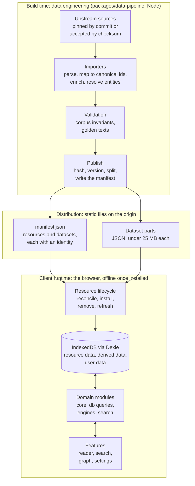

The hard line is between build time and the client. Exactly two things cross it: the manifest and the dataset parts it lists. Nothing in the browser parses a source format, resolves an entity, or maps a verse numbering; all of that is finished before the manifest is written. This is what keeps the client small and makes a data bug fixable by shipping a new dataset version with no app change (D1).

The three systems map onto the code as `packages/data-pipeline` (data engineering), `src/lib/seed.ts` with `packages/db/src/datasets.ts` and the stores around them (resource infrastructure), and the rest of `src/` with `packages/core` and `packages/db` (the application).

Not shown here: executable plugins and the three remote systems (encrypted sync to the user's own storage, the stateless proxy for licensed translations, the later community backend). They are in the end-state diagram in [architecture-decisions.md](architecture-decisions.md) and none of them is on the core study path.

## 2. The eight layers, mapped to the code

The review drew eight layers. They are a fair reading aid, with one exception (layer 6). They are not a package structure: D11 keeps the package tree at four packages until a concrete reason adds a fifth.

| # | Layer | Where it lives | Status | Decided in, tracked by |
|---|---|---|---|---|
| 1 | External data sources | `packages/data-pipeline/src/core/source-registry.ts`: every source with its licence, URL, precedence and pin | built | [data-architecture.md](data-architecture.md) section 2 |
| 2 | Data engineering pipeline | `packages/data-pipeline`: fetch, import, enrich, validate, publish | built; versification mapping and build records planned | [architecture.md](architecture.md); #435, #436 |
| 3 | Resource distribution | `static/data/manifest.json` (format 2) and the dataset parts, served as static files | built for first-party data; content-addressed URLs and the `.csdata` package planned | D1, D5; #442, #52, #312 |
| 4 | Resource lifecycle | `src/lib/seed.ts`, `src/lib/dataset-stream.ts`, `packages/db/src/datasets.ts`, the `translationLibrary` and `datasetStatus` stores | partly: install, remove, refresh and receipts are built; staged updates, integrity checks, repair, cross-tab coordination and the manager UI are planned | D1, D6; #440 to #445, #367, #368 |
| 5 | Persistence and indexing | `packages/db/src/schema.ts`, one Dexie database | built | D2, D3 |
| 6 | Biblical domain services | Not a layer of its own. See section 3 | built as modules; the rules are unenforced | D9, D15, D19; #461 |
| 7 | Application features | `src/routes`, `src/lib/components`, `src/lib/stores` | built; reader decomposition in progress | #362, #363 |
| 8 | Presentation | [design-system.md](design-system.md), CSS custom properties projected from preferences | built | design-system.md |

Dependencies between the packages run one way:

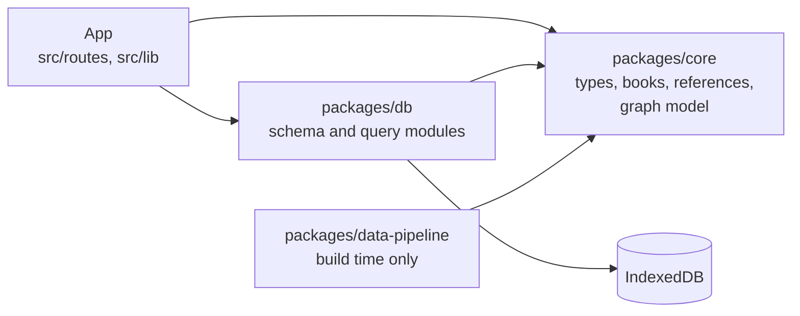

## 3. Where domain logic lives

The review called a "biblical domain services" layer the most important missing component: passage resolution, versification mapping, search, graph traversal and the rest as services that the UI calls, so that no component knows how data is stored.

The concern is right. The remedy is not, for this codebase. The logic already has homes, and D9 and D15 declined service classes and repository interfaces because each would wrap a single implementation.

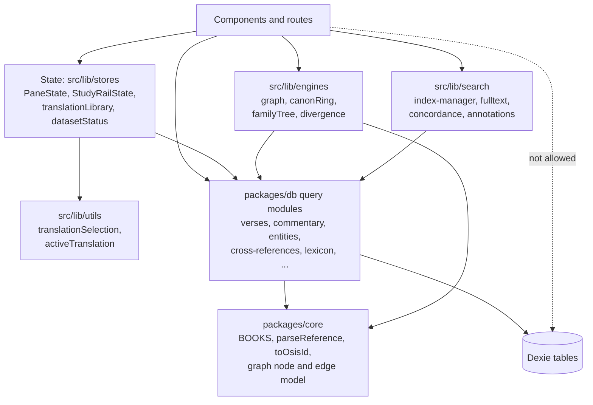

What the review got right is that nothing stops this picture from eroding. Measured on `develop` at `506e9d6`:

- 21 Svelte files import query functions from `@codex-scriptura/db`. That is allowed; the package is the data-access boundary.
- Raw table access (`db.verses`, `db.annotations` and so on) appears 36 times outside `packages/db`, in 8 files. Three of those are whole-database operations that need it (`seed.ts`, `backup.ts`, `storage-measure.ts`). The other five are one engine, three search modules and one component.
- Reference ids are built by string template (`${book}.${chapter}.${verse}`) in 27 places across 16 files, although `toOsisId` and `parseOsisId` exist in core.
- CI runs svelte-check, Vitest and `docs:check`. None of them looks at imports, so every rule here is held by convention and review.

So D19 keeps the modules and adds three rules, to be enforced by a test (#461) instead of by a new layer:

1. **Direction.** Core imports nothing. `db` imports core and Dexie. The app imports both. The pipeline imports core. Nothing imports the app.
2. **Tables.** Only `packages/db` touches Dexie tables. Whole-database operations are allowed by name, with a reason.
3. **References.** A reference id is parsed and built only by core helpers.

A real service interface does arrive, twice, when a second consumer forces it: `TranslationSource` for licensed remote translations (D14, #316), and the Plugin API (D7, #78), which is this same domain layer in serializable, asynchronous form. Building a service layer now would mean building that API early, without the plugins that should shape it.

## 4. Shared ids

Layers describe where code sits. What actually lets a commentary, a cross-reference, a lexicon entry and a user's note meet on the same verse is a small set of id spaces that every dataset and every user record agrees on. This is the part of the architecture that is expensive to get wrong, because ids end up inside user data.

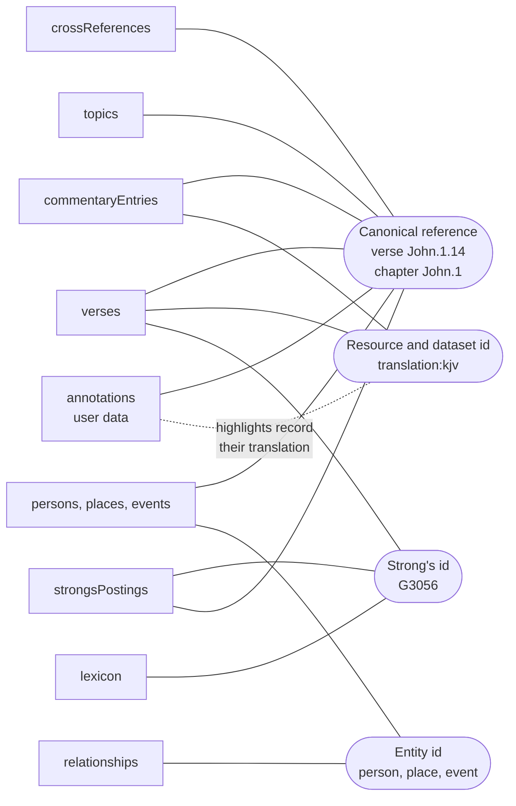

| Id space | Shape | Minted by | Stability | Decision |
|---|---|---|---|---|
| Canonical reference | OSIS book id, chapter, verse: `John.1.14` | A standard, in one fixed numbering | Fixed. A verse never changes id | D17, D18 |
| Strong's id | `H7225`, `G3056` | A standard | Fixed | none needed |
| Entity id | Theographic lookup key: `aaron_1`, `egypt_362` | Upstream, pinned by commit | Stable only while the pin holds. Nothing checks a refresh | D20; #462 |
| Resource id, dataset id | `translation:kjv`, `strongs-index:kjv`, `cross-references` | The pipeline's registries | Stable by convention | D1, D2 |
| Resource-local id | A commentary entry id, a location inside a patristic work | The importer for that resource | Must survive corrections to the text | D20; #42 invariant 2, #434 |

Two rules follow, and D20 records them. User data and links between resources may hold only ids from these spaces. And an id, once shipped, is never reused for something else and never disappears without a recorded alias.

## 5. Opening a passage

The review's example was a reader opening John 1:1, with a passage resolution service coordinating scripture, commentary, lexicon, cross-references, entities and notes. This is the flow as built. There is no coordinator: one reference is resolved once, and each consumer asks for its own data with the same chapter id.

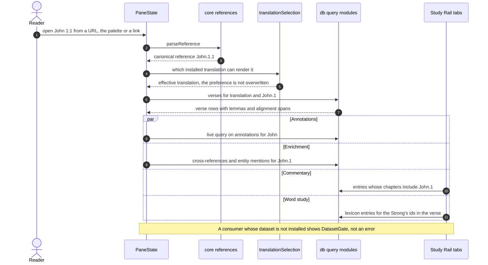

Steps 4 and 5 are D17: whether a translation can render a reference is a capability question answered from what is installed, never a property of the reference. The fan-out is safe because every query is one indexed read keyed by an id from section 4, and a missing dataset degrades one panel, not the page.

The cost of having no coordinator is that a navigation issues several independent queries. That is the right trade while each one is an index read. It is reopened by measurement, not by the diagram.

## 6. Canon and versification

The review is right that this has to be settled before more resources arrive, and the project agrees: #435 exists for it and three v0.6.0 resources depend on it (#141 Douay-Rheims and CPDV, #432 Haydock, #283 the UBS overlay). The review proposed a passage mapping layer that connects reference systems at run time. The decision here (D18) is to map once, at build time, so the device only ever sees one numbering.

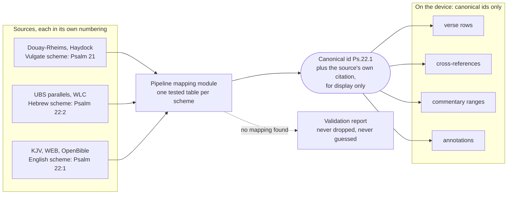

Why build time. A run-time mapping layer has to be called by every query that touches a second resource, so every feature can forget it, and an annotation would need to record which numbering it was made in. Mapping in the pipeline puts the whole problem in one tested module and leaves the client's joins as plain equality on an id.

What it costs. The reader navigates by the canonical numbering. A Douay-Rheims reader opens canonical Psalm 23 and is told it is Psalm 22 in that edition; they cannot yet type "Psalm 22" and mean the Vulgate's. Navigating by a non-canonical scheme belongs to #206 if it is wanted.

Canon is a separate question from numbering, and the review's table mixes two things. A canon is a set of books, an order, and a way of naming and grouping them. The Tanakh's 24 books and the Protestant Old Testament's 39 are the same text divided differently, while the Catholic 73 adds books. So:

- `BOOKS` in core is the superset, at the finest granularity any tradition needs. Baruch and the Letter of Jeremiah stay separate ids even though some traditions print them as one book.
- What a translation contains is its coverage, a fact about the installed data (D17).
- What a tradition counts as scripture is a dataset of membership, order and display name per tradition (#206). Adding a tradition never changes an id.

Still open inside D18, for #435 to settle against real data:

- The canonical numbering is the KJV with Apocrypha (`kjv-versification.ts`, 81 books), but `BOOKS` holds 84. 3 Maccabees, 4 Maccabees and the additional Psalm are numbered however the first importer that brought them numbered them. Each needs a named reference edition.
- The fourth is a live case of the problem this section is about. The Letter of Jeremiah is `Bar.6` in the KJV and `EpJer` chapter 6 in the WEB, so the same text has two canonical ids today depending on the translation it was read in. A note made on it in one does not appear in the other.

## 7. Resources: what one is, what it ships, what it can do

The review's point that type and capability are different things is correct, and the model already separates them. It separates three things, in fact:

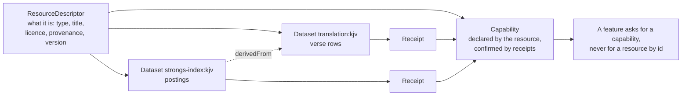

- The **descriptor** says what a resource is and whether it may be used (D2). It says nothing about storage.
- **Datasets** are what a resource ships. One resource can own several, which is how a single lexical resource could later provide definitions, morphology and pronunciation without the model changing. Content stays in per-type tables with per-type indexes; there is no generic content table (D2).
- A **capability** is declared by the resource and confirmed at run time by the receipts of the datasets behind it. Word alignment is declared on a translation but usable only while its Strong's postings are installed.

The one rule that matters (written into #349): no reader code branches on `web` or `kjv`. And the one thing deliberately not done: a capability enum ahead of its consumers. Red letter (#349), licensed-translation limits (D14, #316) and source facsimiles (#433) each add theirs when they land.

## 8. The install lifecycle

The review listed seven failures a resource manager must survive and proposed an eight-state machine: Available, Downloading, Verifying, Staging, Indexing, Activating, Installed, Failed. The failures are the right list. Almost every one already has an issue on the v0.5.1 milestone, which was created for exactly this.

| Failure | Answer | Status |
|---|---|---|
| Download incomplete | The receipt is written last, so an incomplete install has none and reads as absent | built |
| Browser closed mid-install | Same mechanism. The next boot reinstalls | built |
| Checksum or record count wrong | Fail the install, write no receipt | planned, #441 |
| A manifest and its parts from different deploys | Content-addressed part URLs | planned, #442 |
| Storage runs out | Tested as a fault; staged update falls back to destructive when space is short, and says so | planned, #440, #444 |
| A failed update takes the working copy with it | Keep the old copy until a verified replacement is ready | planned, #440 |
| Update incompatible with the app | Format, schema and minimum app version checked before install | planned, #52, #367 |
| Removed while something depends on it | Derived datasets go with their parent (built). Dependencies between packages are parked until one exists | #367, #438 |
| Two tabs install at once | Reproduce first, then an origin-wide lock if needed | planned, #445 |

Where this design differs from the review is in what gets stored. The review's diagram reads as eight persisted states. Persisting a phase is how an installer ends up stuck in "Downloading" forever after a crash. Here the device stores facts, and the phases exist only in memory:

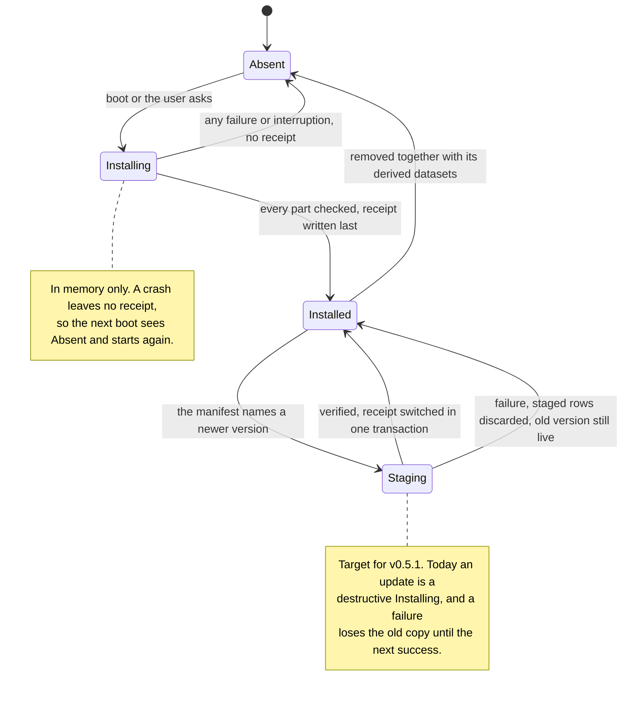

The stored facts are two: a receipt (this dataset, at this version, is complete) and, once #440 lands, a staged copy. Everything the UI shows as progress is derived from those plus in-flight state in `datasetStatus`. A resource is visible to queries only through its receipt, which is the review's own closing rule ("not visible until validated, installed, indexed and activated") in one mechanism.

## 9. Storage classes

D3 already makes the split between replaceable data and user data a rule, and [backup-format.md](backup-format.md) lists which records count as which. Two finer distinctions are worth drawing because they decide what repair, backup and eviction each do:

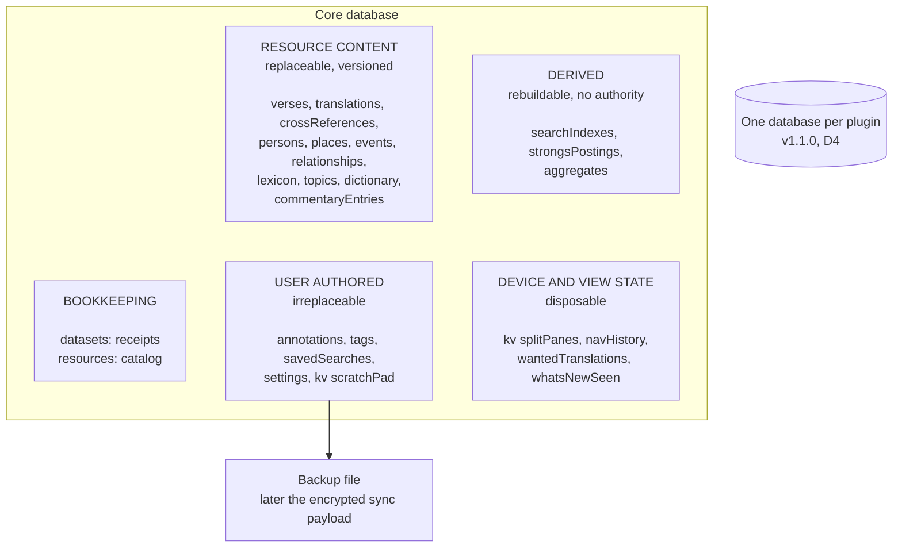

| Operation | Resource content | Derived | User authored | Device state |
|---|---|---|---|---|
| Reinstall or update a resource | replaced | rebuilt | untouched | untouched |
| Remove a resource | removed | removed with it | untouched | untouched |
| Health check and repair (#443) | reinstalled | rebuilt | never written | may be reset |
| Backup export | left out, it downloads again | left out | included | left out |
| Storage evicted by the browser | downloads again | rebuilds | lost unless backed up | lost, harmless |

The last row is the honest limit of an offline-first web app. Separation inside IndexedDB protects user data from the app's own operations; it does nothing against the browser clearing the origin. The defences are the persistent-storage request at boot, the backup file (shipped in v0.4.2), telling the user plainly when persistence was not granted (#443), and sync (v0.8.0). Which browsers the app promises what on is not yet written down; it is an open question in the decision record.

## 10. Search

The review proposed a shared query layer: a parser and planner that decides intent, routes to six specialized indexes, and aggregates. D15 settled search without a service or a planner, and the review does not change that.

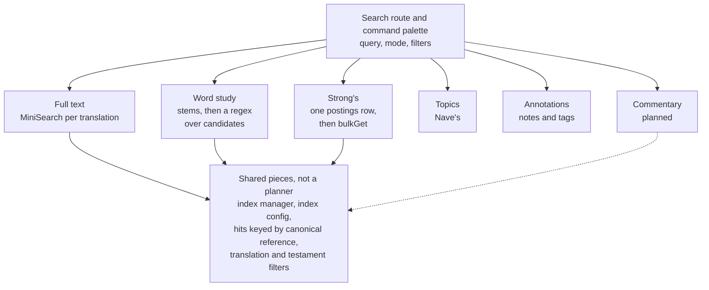

The user picks the mode, so there is no intent to infer. What the modes share is what makes results combinable: every hit resolves to a canonical reference and names the resource it came from.

The review's six example questions are the best argument against building the planner first. Sorted by what each one actually needs:

| Question | What it needs | Status |
|---|---|---|
| My notes tagged Eucharist | The annotation search and tags | built |
| Every occurrence of λόγος in John | Strong's postings for G3056, narrowed to one book | built, bar the book filter |
| Commentaries discussing John 6:53 | The `chapters` index on commentary entries; text search across commentaries | passage lookup built; text search #86 |
| Old Testament passages quoted in Hebrews | Cross-references typed `quotation`, with direction | typed today; directional edges #203 |
| Events involving both Paul and Barnabas | Event search over the entity data, then a condition on two people | #422, then #439 |
| All passages where Peter speaks | A speaker-attribution dataset, which does not exist in the app | #195 |

Four of the six are missing data or a missing filter, not a missing engine. Composing conditions across corpora in one query is real, and it is parked as #439 until the single-corpus features exist to supply its building blocks.

## 11. The knowledge graph

The review asked that the graph become a consumer of structured relationships instead of owning graph logic, that edges carry provenance, and that no graph database be introduced. The first and third are how it is built.

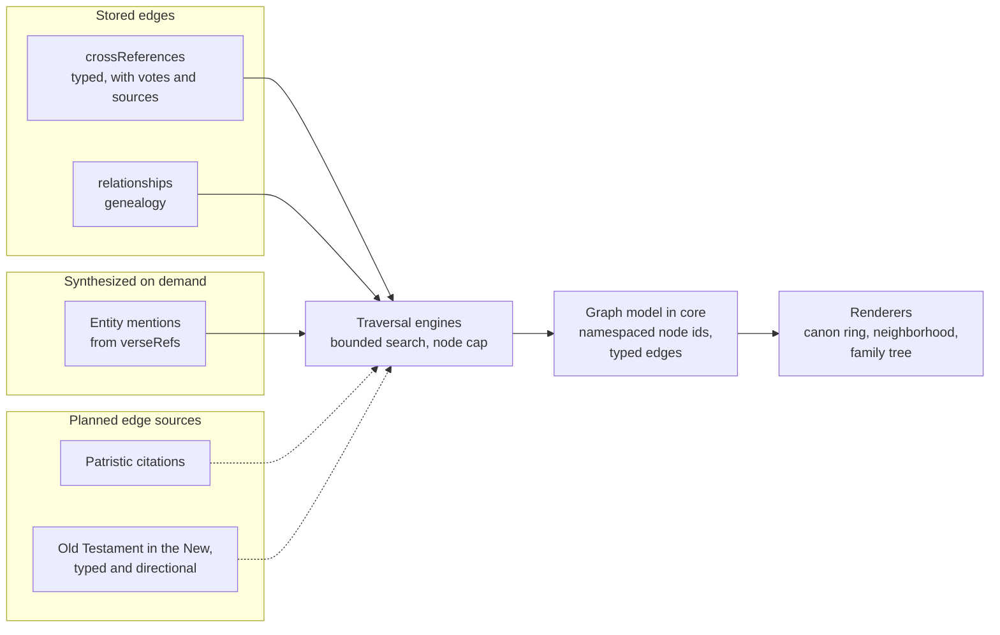

The graph model is renderer-independent and lives in core. The engines read indexed tables; mention edges are synthesized from `verseRefs` instead of stored, which avoids about two million redundant rows. Stable aggregates are computed in the pipeline (D10). A graph database would add a second store to keep consistent, for traversals that are already index reads.

The provenance point is a real gap. A cross-reference record carries its sources, and the pipeline knows whether a link's type came from a published overlay or from a vote heuristic, but `GraphEdge` has a category, a type and a weight and nothing about origin. By the time an edge is drawn, a relationship a source asserted and one the pipeline inferred look the same. #453 is a user-visible case of the graph showing links the data does not hold. #463 tracks carrying origin on the edge.

## 12. How this scales

Five things can grow. Each is carried by a different part of the design, and each has a first limit worth knowing in advance.

| What grows | What carries it | First limit | Tracked by |
|---|---|---|---|
| Resources of a type that exists | Registry entry plus importer; the client finds resources by type, so there is no client change | Each installed translation costs its own search index build on the main thread | #77 |
| Size of one resource | Split into parts under the 25 MB file cap, streamed one part per transaction | Updates briefly need both copies once #440 lands; the hosting file-count limit once parts are content-addressed | #440, #442 |
| Kinds of resource | One table, one query module and one panel per type (D2); the descriptor and lifecycle are shared | Each new type is a schema version and a seeder until `.csdata` carries payload types generically | #52, #312 |
| Total data on a device | Only the wanted set installs; everything else is on demand and removable | Origin quota is shared by everything, and is small and evictable on phones | #443, open question on budgets |
| People and agents changing the code | Decision record, the docs truth check, tests beside each module | Boundaries are convention only; parallel work can each make a reasonable local choice that breaks one | D19; #461 |

The last row is the one the review's own closing argument points at. A longer decision record does not stop two parallel changes from each building a reference id by hand. A failing test does.

## 13. The review, point by point

| Review section | Verdict | Where it stands |
|---|---|---|
| 1. Three systems | Agreed, already the structure | Section 1 |
| Eight-layer diagram | Useful as a reading aid, not as a package plan | Section 2; D11 |
| 2. Domain services layer | Concern accepted, layer rejected. Rules and a test instead | Section 3; D9, D15, D19 |
| 3. Canon and versification | Agreed on priority. Map at build time, not through a run-time layer; canon is a view over a superset of books | Section 6; D17, D18, #435, #206 |
| 4. Resource contract | Already the model. No capability enum before its consumers | Section 7; D2, D14, #349 |
| 5. Install lifecycle | The failure list is right and already scheduled. Store facts, not phases | Section 8; v0.5.1 |
| 6. User data separation | Already a rule. Derived data and device state named as their own classes | Section 9; D3, backup-format.md |
| 7. Search | Shared result contract adopted as a statement; planner rejected until #439 has building blocks | Section 10; D15 |
| 8. Knowledge graph | Already a consumer, no graph database. Edge origin is a real gap | Section 11; D10, #463 |
| 9. | Not included in the material reviewed | |
| 10. Decision records | Already kept as D1 to D17. An index and an entry template added; the fourteen proposed topics are mapped there | [architecture-decisions.md](architecture-decisions.md) |

## 14. Gaps this review found

| Gap | Why it matters | Tracked by |
|---|---|---|
| Architecture rules are not enforced | 36 raw table references and 27 hand-built reference ids already exist outside their owners | #461 |
| Entity ids have no stability rule | A source refresh could renumber a person and nothing would fail; Story Mode and research projects will store these ids | D20; #462 |
| Graph edges do not carry their origin | A sourced link and an inferred one are drawn alike | #463 |
| The canonical numbering was never named, four books sit outside it, and the Letter of Jeremiah has two ids | Every v0.6.0 importer needs the answer, and one case is already live | D18; #435 |
| The deuterocanonical books have text and nothing else | The shipped cross-references hold no verse from them and the canon ring hardcodes 66 books, so a Catholic translation's extra books are dead ends for study | #464 |
| No written support baseline for browsers and storage behaviour | #443 and #445 each need it | Open question in the decision record |
| No written storage or performance budgets | The only number today is the two-second first load in #69 | Open question; first measurements come from #440 |
